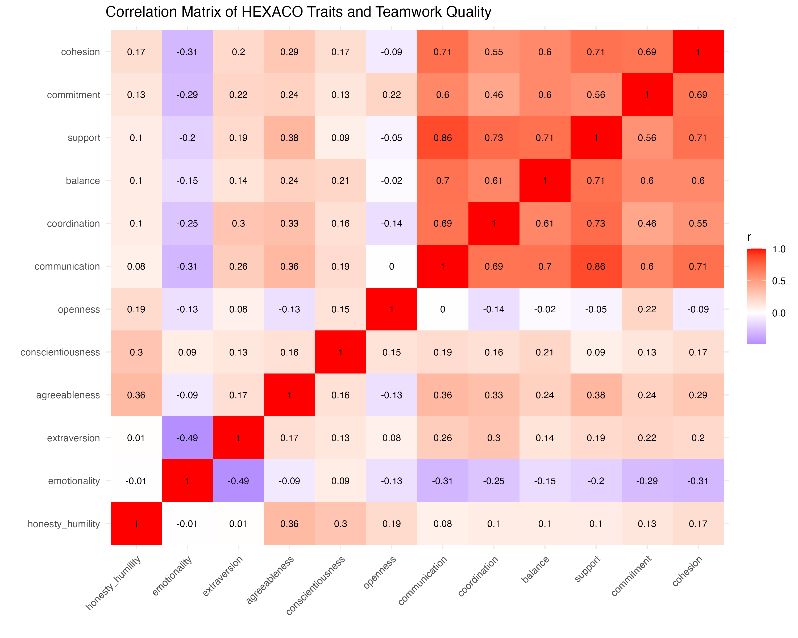
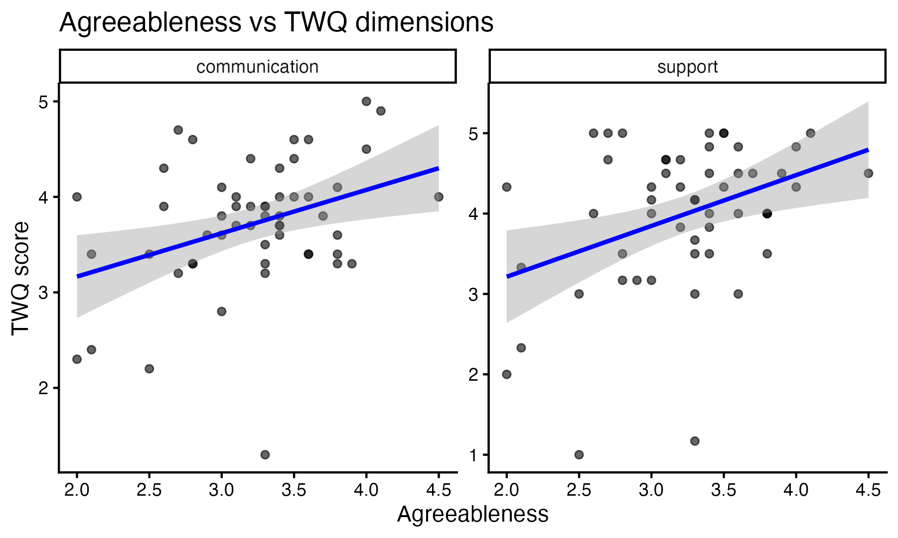
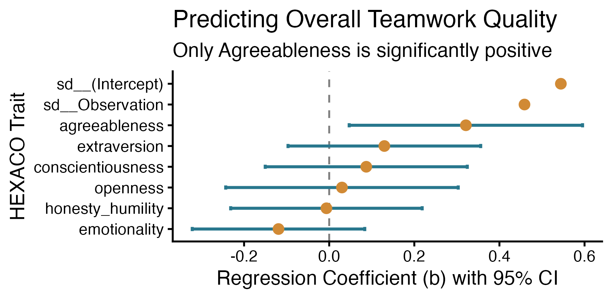

```{r setup, include=FALSE}
knitr::opts_chunk$set(echo = FALSE)
library(ggplot2)
dir.create("figures", showWarnings = FALSE)
```

## Project overview

This project explores associations between HEXACO personality traits
and reported teamwork quality. It also includes an interactive Shiny
app and hypothetical simulations.

Simulated outcomes depend on assumptions and do not establish that
a team-formation strategy improves teamwork in practice.

## Data and scoring

The questionnaire dataset contains 54 respondents from student teams.
The processing script calculates six HEXACO scores, six teamwork
quality scores, and an overall teamwork quality score.

The processing script currently downloads the source data from OSF,
so this step requires an internet connection.

```{r processing}
source("src/data_processing.R")
```

## Descriptive statistics and relationships

```{r analysis}
source("src/data_analysis.R")
knitr::kable(summary_table, row.names = FALSE)
```

```{r heatmap, out.width="100%"}

```

The observed correlation between agreeableness and support is
`r round(cor(df$agreeableness, df$support, use = "complete.obs"), 2)`.
These correlations describe associations, not causal effects.

```{r scatterplots, out.width="100%"}

```

## Mixed-effects models

Both models include a random intercept for team to account for
participants belonging to the same team. The focused model examines
support and agreeableness. The second model examines overall teamwork
quality using all six personality traits.

```{r models}
source("src/mixed_model.R")
summary(model_focused)
summary(model_multi)
```

In the focused model, a one-point increase in agreeableness is associated
with an estimated `r round(lme4::fixef(model_focused)["agreeableness"], 3)`
point difference in support.

The focused relationship was selected after examining correlations,
so its interpretation is exploratory.

```{r forest, out.width="100%"}

```

## Model diagnostics

```{r diagnostics}
performance::check_collinearity(model_multi)

data.frame(
  model = c("Focused support", "Six-trait overall teamwork"),
  singular_fit = c(
    lme4::isSingular(model_focused),
    lme4::isSingular(model_multi)
  )
)

performance::check_normality(model_focused)
performance::check_heteroscedasticity(model_focused)
performance::check_normality(model_multi)
performance::check_heteroscedasticity(model_multi)
```

```{r residual-plots, fig.width=8, fig.height=6}
for (m in list(model_focused, model_multi)) {
  plot(fitted(m), residuals(m),
       xlab = "Fitted values", ylab = "Residuals")
  abline(h = 0, lty = 2)
  qqnorm(residuals(m))
  qqline(residuals(m))
}
```

Residual plots help assess departures from constant variance and
normality. Non-significant diagnostic tests do not prove that
assumptions hold. A non-singular fit alone does not validate a model.

## Simulation

The standalone `data_simulation.R` script generates hypothetical HEXACO
profiles and teamwork-quality outcomes using assumptions described in that
script. It reads processed questionnaire scores from `data/processed_data.csv`,
uses shared calculations from `simulation_core.R`, and saves its outputs under
`simulated_data/`.

The current saved run compares two paired scenarios: low target diversity
(0.20) and high target diversity (0.80), with 500 teams of four people in each
scenario. The tables and figures below show the most recently saved run. They
are simulation results under the stated assumptions, not observed effects in
real teams.

### Simulated teamwork-quality scores

```{r simulation-outcome-summary}
simulated_summary <- read.csv(
  "simulated_data/teamwork_quality_summary.csv",
  check.names = FALSE
)
knitr::kable(
  simulated_summary[, c("Scenario", "outcome_label", "n_participants",
                        "mean_score", "sd_score")],
  digits = 2,
  col.names = c("Scenario", "Outcome", "Participants", "Mean", "SD"),
  caption = "Simulated teamwork-quality score summaries"
)
```

### Achieved diversity

This table compares the requested within-team trait SD with the average SD
actually achieved in the generated teams.

```{r simulation-diversity-summary}
diversity_summary <- read.csv(
  "simulated_data/diversity_summary.csv",
  check.names = FALSE
)
knitr::kable(
  diversity_summary[, c("Scenario", "trait_label", "target_sd",
                        "mean_achieved_sd", "sd_across_teams")],
  digits = 3,
  col.names = c("Scenario", "Trait", "Target SD", "Achieved mean SD",
                "SD across teams"),
  caption = "Target and achieved within-team trait diversity"
)
```

### Paired high-versus-low comparisons

Teams in the high- and low-diversity scenarios are paired in the simulation.
The intervals below describe variation across those simulated teams under the
chosen assumptions; they do not estimate real-world effects.

```{r simulation-paired-summary}
paired_differences <- read.csv(
  "simulated_data/paired_team_level_differences.csv",
  check.names = FALSE
)
knitr::kable(
  paired_differences[, c("outcome_label", "n_teams", "mean_difference",
                         "ci_low", "ci_high", "paired_cohens_dz")],
  digits = 3,
  col.names = c("Outcome", "Teams", "High minus low", "95% CI low",
                "95% CI high", "Paired effect size"),
  caption = "Paired team-level outcome differences"
)
```

### Simulation figures

```{r sim-figure-01, out.width="100%"}
knitr::include_graphics("simulated_data/plots/01_hexaco_score_distributions.png")
```

```{r sim-figure-02, out.width="100%"}
knitr::include_graphics("simulated_data/plots/02_within_team_diversity.png")
```

```{r sim-figure-03, out.width="100%"}
knitr::include_graphics("simulated_data/plots/03_teamwork_outcome_distributions.png")
```

```{r sim-figure-04, out.width="100%"}
knitr::include_graphics("simulated_data/plots/04_teamwork_mean_comparison.png")
```

```{r sim-figure-05, out.width="100%"}
knitr::include_graphics("simulated_data/plots/05_individual_personality_effects.png")
```

```{r sim-figure-06, out.width="100%"}
knitr::include_graphics("simulated_data/plots/06_paired_team_level_differences.png")
```

```{r sim-figure-07, out.width="100%"}
knitr::include_graphics("simulated_data/plots/07_diversity_dose_response.png")
```

```{r sim-figure-08, out.width="100%"}
knitr::include_graphics("simulated_data/plots/08_multivariate_team_diversity.png")
```

```{r sim-figure-09, out.width="100%"}
knitr::include_graphics("simulated_data/plots/09_team_composition_effects.png")
```

```{r sim-figure-10, out.width="100%"}
knitr::include_graphics("simulated_data/plots/10_assumption_sensitivity.png")
```

These figures and tables use the latest generated files in `simulated_data/`.
To refresh them, run the regeneration chunk below before knitting the report.
The chunk is disabled by default because the full simulation takes time to run.

### Simulation sanity checks

The project includes quick, deterministic checks of the shared simulation
logic. They verify that all three grouping strategies create teams of the
requested size, that Balanced and Similar produce the expected between-team
variance ordering on a fixed example, and that zero composition and diversity
effects produce no strategy differences when the residual draws are shared.

```{r simulation-sanity-checks}
source("sanity_checks.R")
```

The variance ordering is checked on a fixed example so the check is
reproducible; a random simulation can occasionally show a different ordering
by chance.

## Interactive app

From this project's RStudio session, run the following chunk manually
to launch the app. It is excluded from knitting because the app stays
running until stopped.

```{r launch-app, eval=FALSE, echo=TRUE}
shiny::runApp("Shiny_App.R")
```

The app uses the bundled simulation output. To regenerate that output,
run this chunk before launching the app:

```{r regenerate-simulation, eval=FALSE, echo=TRUE}
source("data_simulation.R")
```

## Limitations

The sample is small and participants are clustered within teams.
Results are exploratory and do not establish causation.
Scoring choices and missing-response handling should be checked
against the questionnaire documentation.

Simulation results describe hypothetical assumptions, not validated
predictions of real team performance.

## References

- Philipp Zähl (2023), supplementary research data:
  https://osf.io/jb94w/
- Dataset description:
  https://itemresponsewarehouse.org/tables/zaehl2023_hexaco/

## Software information

```{r session}
sessionInfo()
```
